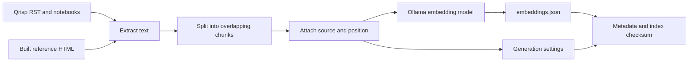
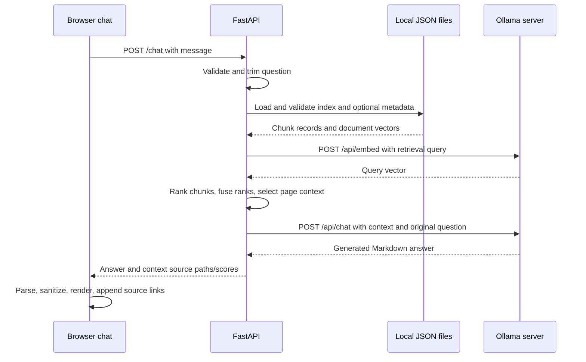

# Architecture and request flow

[Project overview](../README.md)

## System boundary

The assistant has three running components and a precomputed local index:

- The Qrisp Sphinx site serves the JavaScript/CSS chat interface.
- FastAPI receives questions, retrieves documentation, and calls Ollama.
- Ollama serves an embedding model and a chat model over HTTP.
- JSON files hold document vectors and, for newly generated indexes, provenance.

The browser calls FastAPI, never Ollama directly. Qrisp is needed for building
its documentation, but is not imported into the backend. The chatbot does not
execute notebook cells or generated code. Documentation builds are a separate
process governed by the Qrisp checkout's Sphinx configuration.

## Two distinct flows

Indexing is an explicit preparation operation, not part of every chat request:



Each question reuses those document vectors and computes only a query embedding:



Invalid requests stop before retrieval. Invalid indexes stop before an embedding
request. Invalid query vectors or retrieval errors stop before chat generation.
The browser receives a complete response rather than a streamed token sequence.

## Code map

| Location | Entry points / responsibility |
| --- | --- |
| [`src/config.py`](../src/config.py) | `get_docs_root()` resolves the shared input location |
| [`src/ingestion.py`](../src/ingestion.py) | Discovery and RST/notebook/HTML extraction |
| [`src/chunking.py`](../src/chunking.py) | `chunk_text()` and shared size/overlap defaults |
| [`src/pipeline.py`](../src/pipeline.py) | `build_chunks()` attaches source and zero-based position |
| [`src/index_docs.py`](../src/index_docs.py) | `main()` coordinates explicit index generation |
| [`src/embeddings.py`](../src/embeddings.py) | `embed_text()` calls and validates `/api/embed` |
| [`src/vector_store.py`](../src/vector_store.py) | Save/load, raw hybrid ranking, context selection |
| [`src/index_metadata.py`](../src/index_metadata.py) | Build/check generation metadata and file checksum |
| [`src/main.py`](../src/main.py) | Request validation, HTTP routes, prompt, `/api/chat` call |

The Qrisp-side files and browser details are documented in
[API and frontend](api-and-frontend.md). Index schemas and extraction behavior are
documented in [indexing](indexing.md).

## Retrieval step by step

### 1. Prepare the search query

`ChatRequest` strips outer whitespace and rejects blank/non-string messages.
`prepare_retrieval_query()` then removes a narrowly recognized trailing sentence
requesting an example, for example:

```text
Question: How do I measure a QuantumVariable? Show a short Python example.
Search:   How do I measure a QuantumVariable?
```

This is a regular-expression rule, not general intent extraction. Substantive
instructions such as an example using a custom backend are retained. The prompt
still receives the full validated question, including the example request.

### 2. Produce two chunk rankings

`search_embeddings()` embeds the retrieval query using the configured embedding
model. It compares that vector with every saved vector using scikit-learn cosine
similarity. Larger similarities rank first.

BM25 separately ranks the same records
using tokenized `source` plus `text`. Source paths carry identifiers even when a
later chunk contains only parameters or examples. `tokenize()` splits camelCase
and punctuation, lowercases, and retains alphanumeric tokens. It does not perform
general stemming: `example` and `examples` are different tokens.

`expand_query_tokens()` removes scikit-learn's English stopwords and retains
measurement-specific mappings from `measure`, `measuring`, and `measured` to
`measurement` and `get_measurement`. The latter
expanded token does not match the separately tokenized `get`, `measurement`.

### 3. Fuse positions, not raw scores

Reciprocal Rank Fusion assigns each chunk:

```text
RRF = 1 / (60 + semantic_rank) + 1 / (60 + BM25_rank)
```

Ranks start at 1. Both complete rankings contribute; there is no candidate cutoff
or relevance threshold. RRF values are ordering signals, not confidence scores or
probabilities. A query can therefore return high-ranked but unsuitable passages.

### 4. Select pages and expand context

`search_context()` obtains the full raw ranking and calls
`select_context_chunks()`. The latter expects **all** ranked records so it can
retrieve companion chunks even if they ranked poorly individually.

The selector:

1. Looks for recognizable API names in the question: CamelCase names, dotted or
   underscored identifiers, calls such as `uncompute()`, and backticked names.
   It matches them against complete components of source filenames.
2. If no explicit identifier matches, recognizes complete spaced multiword
   CamelCase filenames: `quantum circuit` can match `QuantumCircuit.html`.
   This is a filename heuristic, not Python type introspection or paraphrasing.
3. Restricts candidates to matching pages if any; otherwise retains raw ranking.
4. Selects up to three pages in candidate order. A generated method without a
   Python fenced example can bring in its indexed parent-class page immediately
   after it, using the `generated/qrisp.Class.method.html` layout.
5. For each page, adds its first chunk, best-ranked chunk, and first `Examples`
   heading chunk plus up to two following chunks in document order.
6. Deduplicates by `(source, chunk_index)` and stops at the requested chunk limit.

The route requests ten context chunks. This is a count limit, not a model-token
budget or a guarantee of complete examples. Introductions/continuations retain
their original raw RRF score even when added for context. The final list is
assembled by page, not globally sorted by those scores.

### 5. Generate the answer

`main.chat()` joins selected passages with their source labels and combines them
with instructions and the full question. It sends one `user` message to
`/api/chat`, with `stream: false`. There is no persistent server conversation,
system-role message, tool execution, or generated-code execution.

The prompt asks the model to use documentation, acknowledge gaps, distinguish
classes/execution models, check examples against signatures, and retain imports.
Returned sources identify the selected context. See the
[API contract](api-and-frontend.md#post-chat) for their meaning and response format.

## Implementation boundaries

The store is JSON and retrieval runs in memory. `search_context()` loads the index
to obtain its size and `search_embeddings()` loads it again; metadata validation
and file hashing repeat too. BM25 and similarity inputs are rebuilt per search.
These operations are potential optimization points as the corpus or traffic grows.

There is no vector database, reranker model, provider abstraction, result cache,
or automatic index update. Changing documentation does not update stored vectors
until indexing is explicitly rerun. Changing only the prompt or chat model does
not itself require new document embeddings.
